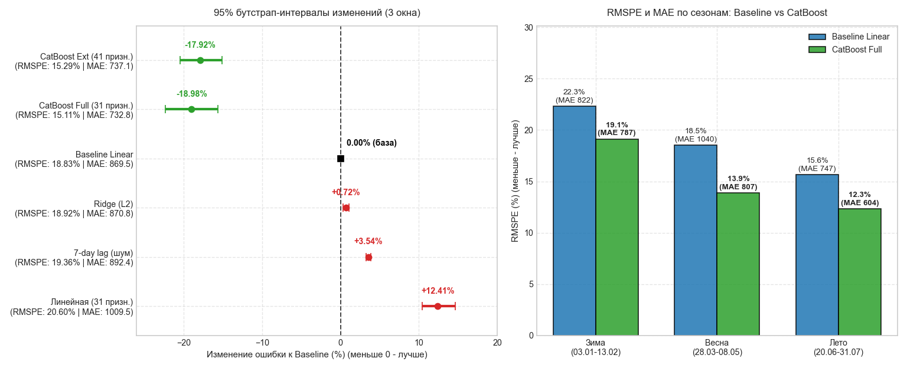
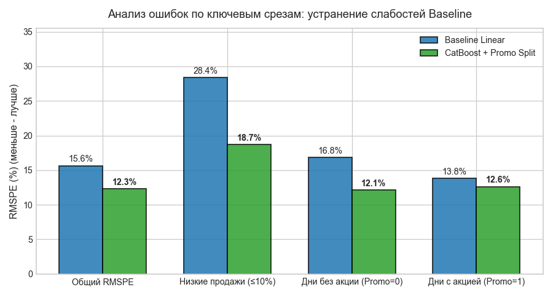
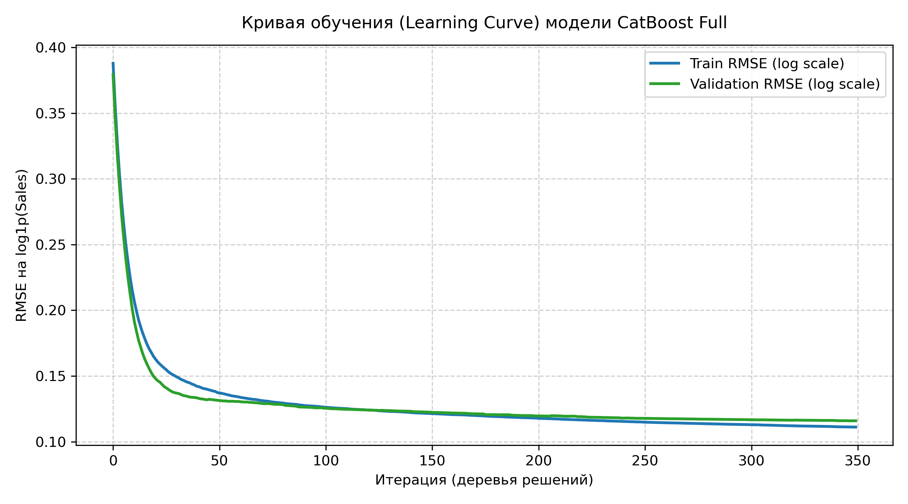
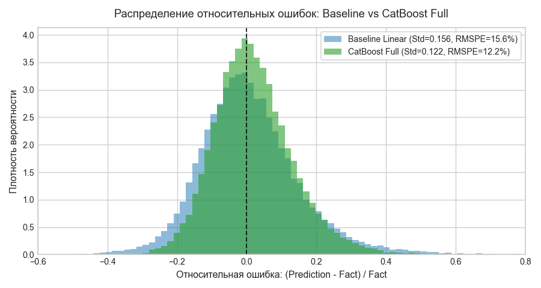
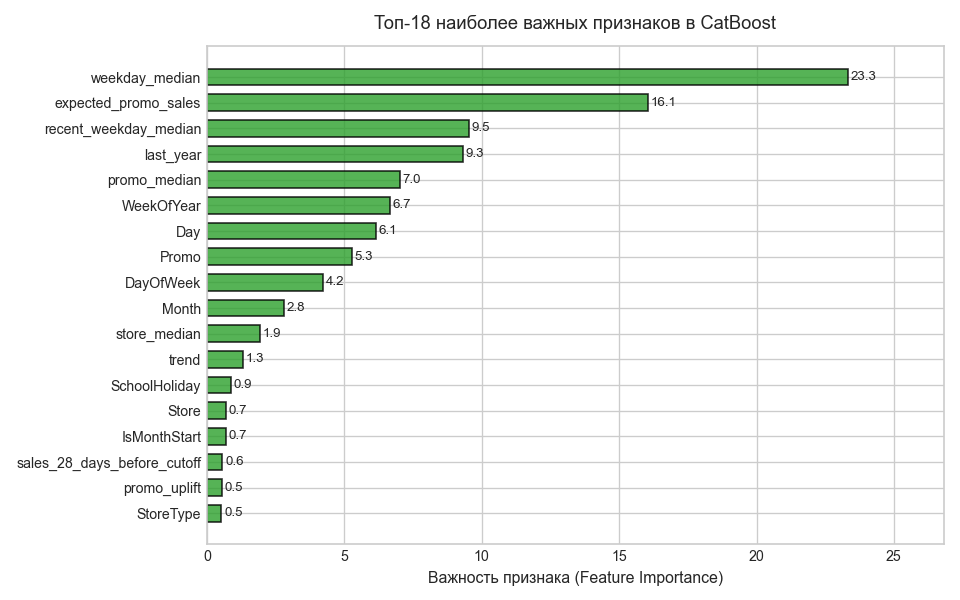

# Rossmann Store Sales

---

# Домашнее задание 1

## 1. Постановка задачи

Прогнозируем дневную выручку каждого магазина Rossmann. Такой прогноз помогает планировать график сотрудников. Для локальной проверки строим прогноз сразу на 42 дня для 1115 магазинов из `train.csv`. [Rossmann Store Sales на Kaggle](https://www.kaggle.com/c/rossmann-store-sales)

В официальном `test.csv` 48 дней и 856 магазинов. Фактической выручки в файле нет, а в 11 строках магазина 622 пропущен `Open`. Для прогноза на эти даты понадобилось бы уточнить график работы или отдельно определить правило для пропусков.

> **Гипотеза.** Если добавить к линейной регрессии признаки из истории, рассчитанные только по данным до начала 42-дневного окна, RMSPE на этом окне снизится как минимум на 5% относительно той же модели без этих признаков.
>
> Базовая модель учитывает типичный уровень продаж каждого магазина и общий для сети недельный профиль. История помогает учесть, как продажи меняются по дням недели в конкретном магазине.

Обе версии линейной регрессии используют магазин, календарь и запланированное промо. Во вторую добавляем девять признаков из истории продаж. Сравниваем версии на одних и тех же строках. Порог выбрали до эксперимента.

## 2. Формализация

| Что | Определение |
|---|---|
| Тип задачи | Прогноз по нескольким временным рядам, по одному на магазин |
| Единица наблюдения | Один день одного магазина (`Store`, `Date`) |
| Цель `y` | Дневная выручка `Sales` |
| Признаки `X` | Номер магазина, день недели, месяц и запланированная акция. Для второй модели добавляем данные о прошлых продажах. График работы `Open` задает правило нулевого прогноза |
| Одно предсказание | Сколько выручки получит магазин в этот день. Если магазин не будет работать, прогноз равен нулю |

В момент прогноза считаем, что на все 42 дня уже известны запланированные акции (`Promo`) и дни, когда магазин будет работать (`Open`). При `Open = 0` ставим прогноз 0, потому что в этот день магазин не работает.

## 3. Данные и их анализ

В `train.csv` 1 017 209 строк по 1115 магазинам, с 1 января 2013 по 31 июля 2015. Для каждого дня записаны выручка, число покупателей, работал ли магазин, была ли акция и был ли праздник. Один магазин встречается в каждой дате максимум один раз. Во всех имеющихся строках поля заполнены.

- У 180 магазинов нет записей за второе полугодие 2014 года. Из-за этого продажи за дату год назад доступны не всегда.
- Почти все записи с нулевой выручкой относятся к дням, когда магазин был закрыт. Нули у открытых магазинов могут быть особенностью учета. По данным нельзя отличить их от дней без продаж.
- В большинстве дней с продажами выручка лежит между 2000 и 12 000. Отдельно проверяем, насколько редкие выбросы влияют на прогноз.
- Чтобы избежать утечки, строим прогноз только по информации, доступной на тот момент. Например, фактическое число покупателей (`Customers`) и выручку за дни, которые предстоит спрогнозировать, узнаем позже. Для проверки откладываем последние даты целиком.

Распределение выручки и сравнение дней с акциями и без них показаны в ноутбуке.

## 4. Базовая модель

Сравниваем две версии линейной регрессии. Первая использует магазин, день недели, месяц и признак акции `Promo`. Вторая дополнительно получает девять признаков из прошлых продаж.

Линейную регрессию легко запустить на CPU. Она дает точку отсчета, где разница между версиями связана с набором признаков из истории. Обе версии используют свободный член и одинаковую точность решателя `tol=1e-6`.

| Исторический признак | Как считаем до даты прогноза |
|---|---|
| Медиана магазина | Медиана положительных продаж магазина |
| Медиана по магазину и дню недели | Медиана положительных продаж для того же дня недели |
| Недавняя выручка | Средняя положительная выручка за последние 28 дней |
| Тренд | За каждую из последних восьми недель считаем среднюю выручку по дням с продажами. Сглаживаем ряд экспоненциальным средним (`span=3`) и берем наклон прямой по сглаженным значениям |
| Продажи год назад | Выручка за дату на 364 дня раньше, чтобы сохранить день недели |
| Типичная выручка во время акций | Медиана положительной выручки за прошлые дни с акциями. Для будущих дней без акции значение признака равно нулю |
| Выручка за 28 дней до прогноза | Выручка магазина ровно за 28 дней до начала окна. Значение одно и то же для всех 42 дат прогноза |
| Разброс недавней выручки | Стандартное отклонение положительной дневной выручки за восемь недель |
| Недавняя выручка в тот же день недели | Медиана положительной выручки в этот день недели за последние восемь недель |

Если данных для средней или медианы нет, используем медиану магазина, а при ее отсутствии медиану по всей сети. Если нет записи год назад или недавней медианы по дню недели, берем медиану по этому дню недели за всю доступную историю магазина. При расчете тренда пропускаем недели без продаж и сохраняем номера остальных недель. Если таких недель меньше двух, ставим ноль. Если дней с продажами меньше двух, разброс тоже равен нулю. Запись за 28 дней до прогноза заменяем медианой магазина только при ее отсутствии.

Для магазина, дня недели и месяца используем one-hot кодирование. Числовые признаки приводим к сопоставимому масштабу.

Обучаемся на днях с положительной выручкой и используем цель `log1p(Sales)`. На шкале выручки промах на 1000 имеет одинаковый вес при факте 2000 и 20 000. На логарифмической шкале он сильнее влияет на обучение при факте 2000. Так штраф за небольшой промах ближе к относительной ошибке, которая важна для RMSPE. После прогноза возвращаемся к исходной шкале через `expm1`, заменяем отрицательные значения нулем и считаем метрики по этим прогнозам.

## 5. Исследовательские вопросы

1. Помогает ли информация о тренде?
2. Добавляют ли прошлогодние продажи полезную информацию?
3. Насколько прогноз чувствителен к разовым выбросам в истории?

## 6. Протокол оценки

| Набор | Даты | Для чего используем |
|---|---|---|
| Трейн (`train.csv`) | Со 2 марта 2013 по 19 июня 2015 | Обучаем модели. Продажи с 1 января по 1 марта 2013 года дают историю для первых обучающих примеров |
| Последнее окно валидации (`train.csv`) | С 20 июня по 31 июля 2015 | Входит в сравнение по трем окнам. На нем подробно разбираем ошибки и считаем интервал для общего выигрыша от истории |

Последнее окно охватывает последние 42 дня `train.csv`. Для каждого окна строим прогноз сразу на весь период по продажам до его начала. При случайном разбиении в обучение могли бы попасть продажи за даты позже тех, на которых проверяем модель.

Метрики и доверительные интервалы считаем на днях с положительной выручкой. Для отдельных вопросов берем нужные магазины или даты.

1. Для обучения делим прошлые даты на 42-дневные окна. Исторические признаки для каждого окна считаем только по продажам до его начала.
2. Кодирование категорий и масштабирование числовых признаков настраиваем только на обучающих данных. Обе модели оцениваем на одних и тех же магазинах и датах.
3. Основная метрика RMSPE учитывает ошибку относительно выручки магазина и совпадает с метрикой контеста. Считаем `(прогноз - факт) / факт` для каждого дня с положительной выручкой, возводим ошибки в квадрат, усредняем и берем корень. На тех же строках считаем MAE, чтобы видеть ошибку в единицах выручки.
4. В каждом окне сравниваем две заранее выбранные версии. Лучшей считаем модель с меньшим RMSPE, а для проверки гипотезы сравниваем относительное снижение с порогом 5%.

Временная валидация включает три 42-дневных окна. Два ранних окна начинаются за 12 и 24 недели до последнего. Для каждого окна заново обучаем модели только на продажах до его начала и считаем признаки по доступной на тот момент истории. По трем окнам считаем среднее и выборочное стандартное отклонение. Сравнения по исследовательским вопросам повторяем на каждом окне по тем же правилам.

### Как проверяем каждый вопрос

1. Тренд. Для каждого окна обучаем полную модель и такую же модель без признака тренда. Сравниваем их на всех днях этого окна с положительной выручкой.
2. Продажи год назад. Обучаем полную модель и такую же модель без продаж за дату 364 дня назад. Оцениваем обе модели на строках, для которых есть прошлогодняя выручка.
3. Выбросы. В истории до валидации отмечаем дни с выручкой не меньше трех медиан для магазина и дня недели. Берем магазины, где такие дни есть и составляют не больше 1% дней с продажами. Удаляем выбросы из копии истории и пересчитываем признаки. Если удаленная строка давала выручку год назад, подставляем среднюю выручку этого магазина за тот же день недели по оставшимся дням с продажами. Сравниваем прогнозы, RMSPE и MAE одной обученной модели на тех же днях валидации. На исходной истории отдельно сравниваем среднее и медиану.

### Как оцениваем значимость различий

Для исследовательских вопросов считаем разницу RMSPE в процентных пунктах. Из RMSPE нового варианта вычитаем RMSPE исходного. Отрицательная разница означает улучшение.

В каждом из 1000 повторов бутстрапа случайно выбираем магазины с возможностью повторов. Берем сразу все дни каждого выбранного магазина и используем одну и ту же выборку для обоих вариантов. По распределению разницы строим доверительные интервалы. Поправку Бонферрони применяем к четырем сравнениям внутри каждого окна.

Даты при бутстрапе фиксированы. Интервалы показывают разброс оценок при изменении состава магазинов внутри окна. Последнее окно уже использовали при разработке, поэтому сравнения считаем предварительными. Ранние окна помогают увидеть, повторяется ли результат на других исторических датах. Вместе эти проверки охватывают три периода одной сети.

## 7. Результаты

### Результаты по трем окнам

| Период в 2015 году | RMSPE без истории | RMSPE с историей | Снижение RMSPE |
|---|---:|---:|---:|
| С 03.01 по 13.02 | 28,02% | 22,33% | 20,31% |
| С 28.03 по 08.05 | 23,39% | 18,50% | 20,88% |
| С 20.06 по 31.07 | 20,33% | 15,64% | 23,05% |
| Среднее | 23,91% | 18,83% | 21,41% |
| Стандартное отклонение | 3,87 п.п. | 3,35 п.п. | 1,45 п.п. |

### Подробности по последнему окну

| Вариант | RMSPE | MAE |
|---|---:|---:|
| Линейная регрессия без исторических признаков | 20,33% | 931,78 |
| Линейная регрессия с историческими признаками | 15,64% | 746,86 |

95%-й бутстрап-интервал для относительного снижения RMSPE на этом окне составил от 21,1% до 24,9%.

### Примеры ошибок

Для каждой группы зафиксировали по одному примеру с ошибкой модели с историей около 90-го процентиля. В ноутбуке берем те же магазины и даты.

| Срез | Магазин и дата | Факт | Прогноз | Ошибка |
|---|---|---:|---:|---:|
| Низкая выручка | 5, 20.06.2015 | 2088 | 2974 | +42,4% |
| День с акцией | 551, 30.07.2015 | 6429 | 7825 | +21,7% |
| День без акции | 475, 06.07.2015 | 5035 | 6082 | +20,8% |

- Магазин 5. Выручка была близка к обычной субботе без акции. Модель с историей завысила прогноз. Возможно, она придала слишком большой вес общей недавней выручке магазина.
- Магазин 551. Выручка была близка к типичному четвергу с акцией. Год назад продажи были выше, и это могло завысить прогноз.
- Магазин 475. В большинстве недавних понедельников шли акции. В день ошибки акции не было, поэтому общая медиана могла завысить прогноз.

На днях с низкой выручкой модель чаще завышает прогноз. RMSPE здесь примерно вдвое выше, чем в остальных группах. Среди остальных дней ошибка почти одинакова с акциями и без них.

## 8. Ответы и вывод

### Ответы на исследовательские вопросы

В первой таблице подробно показаны результаты последнего окна. Интервалы рассчитаны по 1000 повторам бутстрапа с поправкой на четыре сравнения.

| Проверка | RMSPE | Разница и интервал, п.п. | Итог |
|---|---|---|---|
| Добавили тренд | с 15,49% до 15,64% | +0,149 (от +0,125 до +0,174) | Интервал выше нуля |
| Добавили продажи год назад | с 16,31% до 15,62% | -0,696 (от -0,769 до -0,621) | Интервал ниже нуля |
| Убрали выбросы | с 20,40% до 20,32% | -0,073 (от -0,228 до +0,007) | Включает ноль |
| Взяли медиану вместо среднего | с 20,31% до 20,40% | +0,087 (от -0,352 до +0,440) | Включает ноль |

### Сравнения по трем окнам

В таблице указано изменение RMSPE в процентных пунктах, в скобках его интервал. Отрицательное изменение означает снижение ошибки.

| Проверка | 03.01 по 13.02 | 28.03 по 08.05 | 20.06 по 31.07 |
|---|---|---|---|
| Добавили тренд | -0,058 (от -0,160 до +0,044) | +0,008 (от -0,035 до +0,061) | +0,149 (от +0,125 до +0,174) |
| Добавили продажи год назад | -0,003 (от -0,094 до +0,064) | -0,202 (от -0,313 до -0,120) | -0,696 (от -0,769 до -0,621) |
| Убрали выбросы | +0,006 (от -0,015 до +0,032) | -0,136 (от -0,514 до +0,014) | -0,073 (от -0,228 до +0,007) |
| Взяли медиану вместо среднего | +0,340 (от -0,977 до +1,051) | +0,009 (от -0,896 до +0,694) | +0,087 (от -0,352 до +0,440) |

Размеры срезов в формате «строки с положительной выручкой / магазины».

| Проверка | 03.01 по 13.02 | 28.03 по 08.05 | 20.06 по 31.07 |
|---|---:|---:|---:|
| Добавили тренд | 39 923 / 1 115 | 37 044 / 1 115 | 40 282 / 1 115 |
| Добавили продажи год назад | 39 923 / 1 115 | 37 044 / 1 115 | 35 252 / 1 115 |
| Убрали выбросы | 1 293 / 36 | 1 287 / 39 | 1 363 / 38 |
| Взяли медиану вместо среднего | 1 293 / 36 | 1 287 / 39 | 1 363 / 38 |

В проверке чувствительности для последнего окна удалили из истории 55 выбросов. Если удаленная запись давала выручку год назад, заменяли ее средним по магазину и дню недели.

После удаления выбросов большинство прогнозов изменилось мало. Сильнее всего снизился прогноз магазина 303, где высокая выручка год назад была одним из признаков.

### Общий вывод

История продаж снизила RMSPE в среднем на 21,41%. Во всех трех окнах снижение превысило порог гипотезы в 5%. Для последнего окна доверительный интервал тоже целиком выше этого порога. Проверка охватывает три периода одной розничной сети.

Прошлогодняя выручка снизила RMSPE в двух окнах с интервалами ниже нуля. В зимнем окне разница была близка к нулю. Сглаженный тренд ухудшил прогноз в последнем окне, а в ранних окнах интервалы включают ноль. Для удаления выбросов и замены среднего медианой интервалы включают ноль во всех окнах.

Модель чаще завышала прогноз в дни с низкой выручкой. Следующая гипотеза состоит в том, что раздельные недавние медианы для дней с акцией и без нее снизят RMSPE на днях без акции из нижних 10% по положительной выручке. В этом срезе также проверим долю завышений. По всему окну проверим, что RMSPE не вырос. Срез определим после прогноза по фактической выручке.

## Воспроизведение

Скачайте архив Rossmann и распакуйте `train.csv` в `data/`. Выполняйте команды из корня проекта. Используйте Python 3.13.7, на нем проверен запуск под Windows. Для обучения достаточно CPU. [Скачать данные](https://www.kaggle.com/c/rossmann-store-sales/data?select=train.csv)

### Windows (PowerShell)

```powershell
python -m venv .venv
.\.venv\Scripts\python.exe -m pip install -r requirements.txt
.\.venv\Scripts\python.exe -m src.run_baseline --config configs/baseline.json
.\.venv\Scripts\python.exe -m nbconvert --to notebook --execute --inplace notebooks/analysis.ipynb
```

### Linux (Bash)

```bash
python3.13 -m venv .venv
.venv/bin/python -m pip install -r requirements.txt
.venv/bin/python -m src.run_baseline --config configs/baseline.json
.venv/bin/python -m nbconvert --to notebook --execute --inplace notebooks/analysis.ipynb
```

Команда обучения сохраняет метрики в `artifacts/baseline/metrics.json`, а прогнозы для валидации в `artifacts/baseline/predictions.csv`. Последняя команда пересчитывает графики и таблицы. [Ноутбук с анализом](notebooks/analysis.ipynb)

| Путь | Содержимое |
|---|---|
| `configs/baseline.json` | Пути, горизонт, порог улучшения и настройки повторной оценки |
| `src/data.py` | Загрузка данных, временные окна и признаки |
| `src/train.py` | Обучение и прогноз линейной регрессии |
| `src/evaluate.py` | Метрики, сводка данных и бутстрап |
| `src/run_baseline.py` | Запуск всех сравнений |
| `notebooks/analysis.ipynb` | Графики и интерпретация результатов |

## Источники и вклад

Задачу, данные и метрику взяли из контеста Rossmann на Kaggle. Гипотеза и исследовательские вопросы лично мои. Хоть гипотеза и базовая, но я встречал задачи, в которых исторические фичи не добавляли почти никакого аплифта, поэтому она все еще требует проверки. Код и отчет готовил с помощью Codex.

---

# Домашнее задание 2

## 1. Улучшения и новые гипотезы

В конце ДЗ 1 мы отметили две главные слабости baseline: модель завышала выручку на днях с низкими продажами (в среднем на 15.8% на нижних 10% дней) и в дни без акции после промо-недели. Кроме того, в первом задании не использовался файл store.csv, а линейная регрессия не могла учитывать совместное влияние признаков.

Для второго этапа сформулировано шесть гипотез:

1. Метаданные магазинов. Признаки из store.csv (тип магазина StoreType, ассортимент Assortment, расстояние до конкурента CompetitionDistance, факт и возраст открытия конкурента, статус Promo2) помогут точнее задать базовый уровень продаж конкретного магазина.
2. Разделение истории по промо и календарь. Раздельный расчет недавних медиан для дней с акцией и без нее устранит завышение прогноза в дни без акций. Дополнительно добавляем день месяца и даты выплат (1-е и 15-е числа).
3. Недавний темп продаж (7-дневный лаг). Средняя выручка магазина за последнюю неделю перед тестом поможет модели быстрее реагировать на свежие изменения спроса и снизит ошибку прогноза.
4. Регуляризация линейной модели. Базовая линейная модель чувствительна к шуму и склонна к переобучению. Добавление L2-регуляризации ограничит рост весов, защитит от переобучения и улучшит обобщающую способность модели.
5. Переход к CatBoost. Градиентный бустинг деревьев с нативной обработкой категорий выявит нелинейные зависимости между промо, днем недели, типом магазина и расстоянием до конкурентов.
6. Насыщение признакового пространства (CatBoost Extended). Добавление еще 10 фичей (взаимодействие Promo и дня недели, комбинация StoreType и Assortment, дни до конца месяца, волатильность продаж, близкий конкурент, темп 4w/8w, циклические гармоники) позволит проверить гипотезу о том, где наступает предел полезности признаков для CatBoost.

## 2. Протокол честного сравнения

Для всех экспериментов сохраняем неизменными:
- Один и тот же временной сплит: три 42-дневных окна 2015 года (основное окно с 20 июня по 31 июля, два ранних окна со сдвигом на 12 и 24 недели назад).
- Расчет признаков строго до даты отсечки: информация о конкурентах и продажах берется только до начала окна прогноза.
- Единую метрику: RMSPE и MAE считаем на днях с положительными продажами при Open = 1. При Open = 0 прогноз равен нулю.
- Фиксированный seed = 42 для обучения и 1000 повторов бутстрапа по магазинам.
- Обработка пропусков в store.csv: при отсутствии конкурента расстояние CompetitionDistance заполняется удвоенным максимумом с логарифмированием и флагом has_competition = 0; неизвестные даты открытия конкурента и старта Promo2 закрываются фиктивным годом (9999), что корректно обнуляет статус их активности.

## 3. Результаты экспериментов

Основная оценка моделей проводится по трем 42-дневным окнам (зима, весна и лето 2015 года), чтобы проверить временную устойчивость. Для ориентира в отдельной колонке приведен RMSPE на основном (летнем) окне из ДЗ 1. Отрицательное изменение означает снижение ошибки относительно базовой линейной модели.

| Эксперимент | Модель | Число признаков | 3 окна RMSPE | 3 окна MAE | Изменение к baseline (3 окна) | 95% интервал (3 окна) | RMSPE (окно 3, справка) | Итог |
|---|---|---:|---:|---:|---:|---:|---:|---|
| exp0_baseline_linear | linear | 10 | 18.83 ± 3.35% | 869.5 ± 152.0 | 0.00% | - | 15.64% | Базовая модель |
| exp1_ridge | ridge | 10 | 18.92 ± 3.63% | 870.8 ± 140.2 | +0.72% | [+0.36%, +1.10%] | 15.58% | Интервал выше нуля |
| exp2_noisy_7d_lag | ridge | 11 | 19.36 ± 4.32% | 892.4 ± 139.1 | +3.54% | [+3.24%, +3.89%] | 15.61% | Ухудшение, интервал выше нуля |
| exp3_features_linear | ridge | 31 | 20.60 ± 6.71% | 1009.5 ± 276.8 | +12.41% | [+10.45%, +14.63%] | 16.18% | Ухудшение, интервал выше нуля |
| exp4_catboost_full | catboost | 31 | 15.11 ± 3.56% | 732.8 ± 111.8 | -18.98% | [-22.37%, -15.63%] | 12.32% | Интервал ниже нуля |
| exp5_catboost_extended | catboost | 41 | 15.29 ± 3.71% | 737.1 ± 111.9 | -17.92% | [-20.41%, -15.13%] | 12.50% | Насыщение: хуже Full на 0.20 п.п. |

Примечание к числу признаков: в таблице указано количество исходных колонок датафрейма (10, 31 и 41). В линейных моделях колонка Store кодируется через One-Hot Encoding в 1115 бинарных столбцов (по числу магазинов), поэтому реальная матрица признаков расширяется до 1124 столбцов (1115 столбцов магазинов плюс 9 числовых признаков). CatBoost обрабатывает магазин и категории нативно без раздувания матрицы.

Главный итог по экспериментам:
Из линейной модели больше выжать не получается: L2-регуляризация дает незначительный эффект, короткий лаг ухудшает прогноз, а 31 признак перегружает линейную форму. Переход на CatBoost Full (31 признак) дает качественный скачок, снижая ошибку на 18.98% по пулу трех окон (с 18.83% до 15.11%).
При этом проверка расширенного набора (exp5_catboost_extended с 41 признаком) подтвердила гипотезу о насыщении: добавление еще 10 признаков не улучшило результат, а привело к росту ошибки на 0.20 п.п. (с 15.11% до 15.29%, 95% интервал к Full: [+0.04 п.п., +0.45 п.п.]). Базовый набор из 31 признака оптимален, а дальнейшее усложнение только добавляет шум.

## 4. Абляционные проверки

Для оценки вклада отдельных улучшений от полной модели CatBoost по очереди отключались группы признаков (или заменялась модель на тех же признаках). Сравнение приведено по трем окнам относительно CatBoost Full:

| Вариант | Что отключено / изменено | Число признаков | 3 окна RMSPE | 3 окна MAE | Изменение RMSPE к Full (3 окна) | 95% интервал к Full (3 окна) | RMSPE (окно 3, справка) | Вывод |
|---|---|---:|---:|---:|---:|---:|---:|---|
| exp4_catboost_full | Полная модель (все признаки) | 31 | 15.11 ± 3.56% | 732.8 ± 111.8 | 0.00 п.п. | - | 12.32% | Ориентир (наилучшее качество) |
| ablation1_no_store_meta | Без store.csv (формат, ассортимент, конкуренты) | 22 | 15.62 ± 3.63% | 758.5 ± 123.0 | +0.50 п.п. | [+0.44 п.п., +0.57 п.п.] | 12.66% | Метаданные формата и конкурентов помогают модели |
| ablation2_no_promo_split | Без разделения промо-истории | 25 | 14.91 ± 2.83% | 720.8 ± 116.2 | -0.32 п.п. | [-0.42 п.п., -0.22 п.п.] | 12.34% | RMSPE почти не изменился, но MAE вырос на днях без акций |
| ablation3_no_calendar | Без календаря (день месяца, зарплатные даты) | 25 | 16.71 ± 4.89% | 834.9 ± 163.7 | +1.80 п.п. | [+1.45 п.п., +2.03 п.п.] | 12.94% | Ошибка заметно выше; календарь стабилизирует прогноз во времени |
| exp3_features_linear | Замена модели: Ridge на том же полном наборе | 31 | 20.60 ± 6.71% | 1009.5 ± 276.8 | +5.97 п.п. | [+5.08 п.п., +7.32 п.п.] | 16.18% | Линейная форма уступает бустингу, вероятно, из-за нелинейных эффектов и корреляций |

Главный итог по абляциям:
Наибольший вклад в стабильность CatBoost во времени вносят календарные признаки (день месяца и даты выплат: без них ошибка на 3 окнах растет на 1.80 п.п., разница средних +1.60 п.п.) и метаданные магазинов (без них ошибка растет на 0.50 п.п., оба интервала строго выше нуля). Разделение промо-истории почти не меняет общий RMSPE, но снижает MAE и убирает завышение прогноза в дни без акций. Сравнение с линейной моделью на том же наборе фичей (+5.97 п.п. по бутстрапу) подтверждает, что решающую роль играет способность бустинга работать со сложными взаимодействиями признаков.

## 5. Анализ ошибок по срезам

На основном окне проверили, как изменилась ошибка в проблемных группах, выделенных в ДЗ 1:

| Срез | Число строк | RMSPE baseline | RMSPE CatBoost | Смещение baseline | Смещение CatBoost |
|---|---:|---:|---:|---:|---:|
| Все дни с продажами | 40 282 | 15.64% | 12.32% | +1.09% | +1.99% |
| Низкая выручка (нижние 10%) | 4 029 | 28.39% | 18.70% | +15.77% | +8.81% |
| Дни без акции (Promo = 0) | 23 581 | 16.81% | 12.11% | +1.91% | +0.34% |
| Дни с акцией (Promo = 1) | 16 701 | 13.83% | 12.62% | -0.05% | +4.33% |

Главный итог по анализу ошибок:
Удалось устранить ключевые уязвимости baseline, обнаруженные в первом задании. В проблемной группе с низкой выручкой RMSPE упал с 28.39% до 18.70%, а систематическое завышение прогноза сократилось почти вдвое (с +15.77% до +8.81%). На днях без акций систематическое завышение снизилось с +1.91% до околонулевых +0.34%, а ошибка между промо-днями и обычными днями выровнялась (12.62% и 12.11% против 13.83% и 16.81% у baseline).

## 6. Графики

### Сравнение моделей и доверительные интервалы


### Анализ ошибок по срезам (низкие продажи и промо)


### Кривая обучения CatBoost


### Распределение остатков моделей


### Важность признаков


## 7. Выводы по ДЗ 2

Переход на CatBoost и добавление признаков снизили RMSPE с 15.64% до 12.32% на основном окне (снижение на 21.22%, доверительный интервал от 18.62% до 23.62%). По трем окнам средняя ошибка снизилась с 18.83% до 15.11%.

В связке с CatBoost раздельные медианы и признаки помогли снизить ошибку на днях с низкой выручкой с 28.39% до 18.70%. Календарные признаки дня месяца снизили ошибку на 0.62 п.п. на основном окне и на 1.80 п.п. по бутстрапу трех окон (+1.60 п.п. по разнице средних).

Что не сработало и почему:
- Гипотеза о пользе 7-дневного лага не подтвердилась. На основном окне недельный срез не дал значимого эффекта: доверительный интервал изменения ошибки включает ноль (от -0.47% до +0.09%), а по пулу трех окон ошибка статистически значимо выросла на +3.54% (95% ДИ: [+3.24%, +3.89%]). Локальные краткосрочные лаги без регулярного обновления внутри тестового окна быстро устаревают и вносят случайный шум.
- Попытка использовать все 31 признак в линейной модели на основном окне привела к ухудшению RMSPE на 3.45% (с 15.64% до 16.18%), а по трем окнам - на 12.41% (с 18.83% до 20.60%). Причина заключается во взаимной корреляции признаков и неспособности линейной формы улавливать нелинейные эффекты. Бустинг на том же наборе данных, напротив, показал наилучший результат.
- Проверена граница насыщения признакового пространства: добавление еще 10 производных признаков (эксперимент exp5 с 41 признаком) не улучшило качество, а привело к росту ошибки на 0.20 п.п. (с 15.11% до 15.29%, 95% интервал к Full: [+0.04 п.п., +0.45 п.п.]). Набор из 31 признака в CatBoost Full является достаточным и оптимальным.

## 8. Воспроизведение

Выполняйте команды из корня проекта.

### Windows (PowerShell)
```powershell
python -m venv .venv
.\.venv\Scripts\python.exe -m pip install -r requirements.txt
.\.venv\Scripts\python.exe -m src.run_baseline --config configs/baseline.json
.\.venv\Scripts\python.exe -m src.run_experiments --config configs/hw2.json
.\.venv\Scripts\python.exe -m src.visualize
.\.venv\Scripts\python.exe -m nbconvert --to notebook --execute --inplace notebooks/analysis.ipynb
```

### Linux (Bash)
```bash
python3.13 -m venv .venv
.venv/bin/python -m pip install -r requirements.txt
.venv/bin/python -m src.run_baseline --config configs/baseline.json
.venv/bin/python -m src.run_experiments --config configs/hw2.json
.venv/bin/python -m src.visualize
.venv/bin/python -m nbconvert --to notebook --execute --inplace notebooks/analysis.ipynb
```

## 9. Структура репозитория

```text
kaggle_rossmann_store_sales/
├── artifacts/
│   ├── plots/                        # Графики сравнения моделей, срезов и кривых обучения
│   ├── experiments_summary.json      # Итоговые метрики и бутстрап-интервалы всех 9 экспериментов
│   └── experiments_table.md          # Таблицы экспериментов и абляций
├── configs/
│   ├── baseline.json                 # Конфигурация базовой модели (ДЗ 1)
│   ├── hw2.json                      # Конфигурация для запуска всех экспериментов ДЗ 2
│   └── experiments/                  # Индивидуальные конфигурации 9 экспериментов и абляций
├── data/                             # Данные соревнования (train.csv, store.csv, test.csv)
├── notebooks/
│   ├── analysis.ipynb                # Интерактивный анализ результатов, графики и срезы (ДЗ 2)
│   └── analysis_hw1.ipynb            # Ноутбук с результатами первого этапа (ДЗ 1)
├── src/
│   ├── data.py                       # Загрузка данных, временные сплиты, генерация признаков
│   ├── train.py                      # Обучение моделей (Linear, Ridge, CatBoost)
│   ├── evaluate.py                   # Метрики (RMSPE, MAE), анализ срезов и кластерный бутстрап
│   ├── visualize.py                  # Построение графиков и кривых обучения
│   ├── run_baseline.py               # Запуск базовой модели ДЗ 1
│   └── run_experiments.py            # Оркестратор экспериментов и абляций ДЗ 2
├── requirements.txt                  # Зависимости проекта
└── README.md                         # Полный отчет по ДЗ 1 и ДЗ 2
```

## Источники и вклад

Задачу, данные и метрику взяли из контеста Rossmann на Kaggle. Гипотезы и абляции лично мои. Код и отчет готовил с помощью Codex.